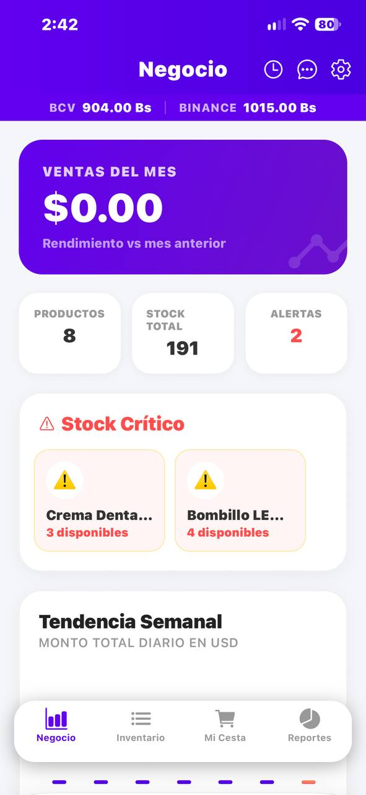
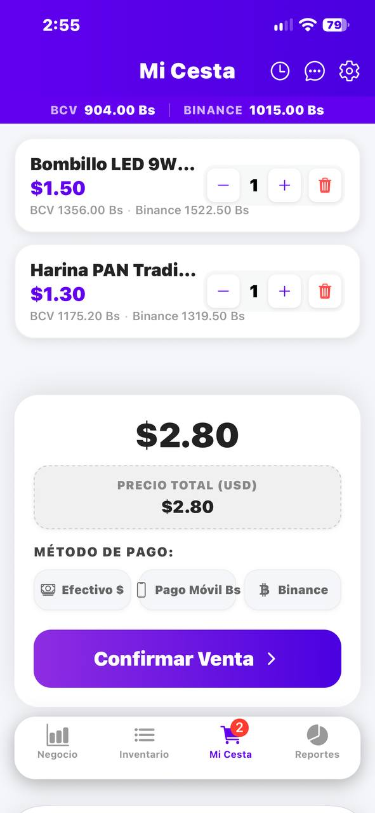
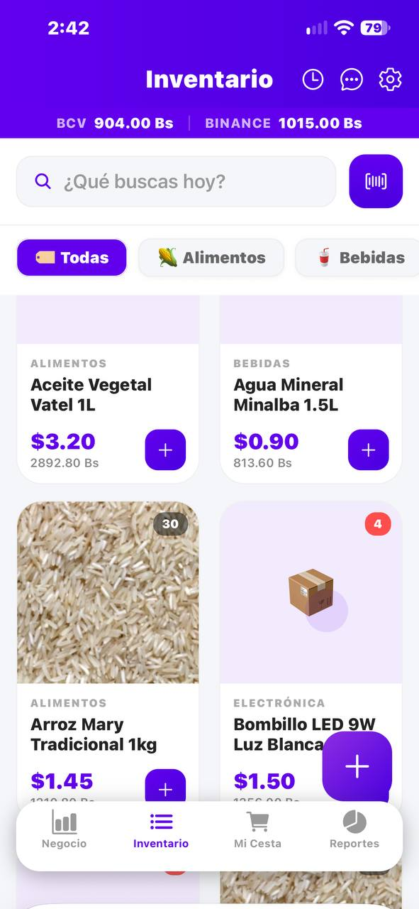
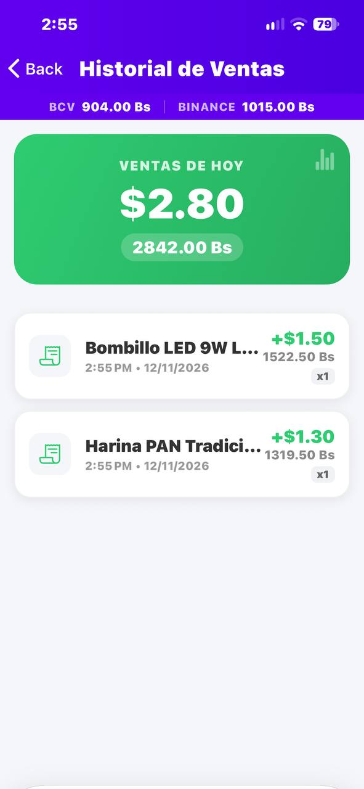

# Sales & Inventory Control System — Commercial Management Platform

### _An agile point-of-sale, multi-currency inventory tracking, and daily cash-balance management solution for retail and commercial businesses._

> [!IMPORTANT]
> **Proprietary Commercial Software**  
> The complete source code and infrastructure configurations for this system are private and maintained for proprietary commercial operations. This repository serves as an architectural case study, technical showcase, and product portfolio overview. Private live demonstrations, technical walkthroughs, or licensing inquiries are available upon request.

---

## 1. Executive Summary

### The Challenge

Small and medium retail establishments (convenience stores, grocery shops, and specialized retail businesses) consistently face friction points that undermine profitability:

- **Manual Checkout Inefficiencies:** Slow transactions and handwriting errors that degrade customer experience during peak business hours.
- **Multi-Currency Discrepancies:** In environments operating with dual-currency mechanics (e.g., local currency pegged to volatile real-time exchange rates vs. USD benchmarks), calculating accurate conversions on the fly introduces severe cashier imbalance.
- **Invisible Inventory Shrinkage:** Lack of stock thresholds leading to unmonitored stock-outs of high-velocity products or undetected inventory loss.
- **Opaque Cash Reconciliation:** End-of-day balances compiled through fragmented receipts and disparate payment channels (cash, mobile payments, and digital transfers) with no centralized ledger.

### The Solution

The **Sales & Inventory Control System** solves these challenges by integrating a streamlined mobile/tablet Point-of-Sale (POS) interface with an optimized transactional PHP/MySQL backend:

- **Instantaneous Barcode & Cart Workflow:** Accelerated checkout with real-time barcode scanning and on-the-fly multi-rate conversion.
- **Deterministic Stock Control:** ACID-compliant inventory deductions preventing overselling and phantom stock.
- **Automated Daily Cash Balancing:** Instant segregation of totals by payment method (cash USD, domestic mobile payment, and digital reference transfers) paired with instant digital receipt generation.
- **Actionable Business Intelligence:** Real-time dashboard analytics tracking month-over-month performance, sales velocity, and critical inventory alerts.

---

## 2. Core Functional Modules

- **Point of Sale (POS) & Smart Checkout (`CartScreen`):**
  - Fast cart aggregation with quantity adjustment, real-time subtotal calculations, and dynamic dual-currency toggles (Official Exchange Rate vs. Benchmark Rate).
  - Support for multi-modal payments: Cash (USD), Mobile Banking (Pago Móvil / Local Currency), and Digital Transfers (Binance/Ref).
  - Direct generation of formatted digital receipt tickets via native PDF rendering and system sharing.

- **Inventory Management & Barcode Scanning (`InventoryScreen`, `AddProductScreen`, `EditProductScreen`):**
  - Catalog organization categorized by functional retail groups with custom tags, icons, and color badges.
  - Real-time camera-driven barcode scanner for instant item lookup and stock registration.
  - Visual stock depletion warning badges and dedicated filtering by category and search queries.

- **Executive Dashboard & Real-Time Analytics (`DashboardScreen`):**
  - Month-over-month revenue tracking with percentage growth differentials.
  - 7-day rolling revenue trend visualization with dynamic daily volume bars.
  - Revenue breakdown by payment gateway to analyze customer payment preferences.
  - Top-performing items ranking and instant critical stock warning carousel.

- **Daily Cash Closure & Reconciliation (`CashClosureScreen`):**
  - Automated aggregation of all transactions executed during the business day starting at midnight.
  - Precise reconciliation per tender type: USD cash drawer, local currency bank transfers, and digital settlements.
  - One-tap executive closing dispatch directly to business stakeholders via automated messaging links.

- **Audit Log & Sales History (`SalesHistoryScreen`):**
  - Chronological ledger displaying timestamped itemized receipts, cashier identity, exchange rates applied at time of purchase, and tender types.

- **Role-Based Access Control (RBAC) & Configuration (`LoginScreen`, `SettingsScreen`):**
  - Granular profile permissions enforcing strict boundary controls between `admin` (full financial analytics, inventory mutation, rate modifications) and `vendedor` (POS checkout and history viewing).
  - Centralized business profile management (legal identifier, store name, contact numbers, address, and receipt farewell notes).

---

## 3. System Architecture & Tech Stack

### Data Flow & Communication Topology

```text
+-------------------------------------------------------------------------+
|                        Client Application Layer                         |
|      (React Native 0.86 / Expo SDK 57 / React 19 / Context API)         |
+-------------------------------------------------------------------------+
           |                                             ^
    JSON REST Requests                            JSON Responses
  (POST/GET with Actions)                         (State Payloads)
           v                                             |
+-------------------------------------------------------------------------+
|                           API Gateway Layer                             |
|                           (api.php Router)                              |
+-------------------------------------------------------------------------+
       |                  |                    |                  |
       v                  v                    v                  v
+--------------+  +---------------+  +------------------+  +--------------+
| productos.php|  |  cierre.php   |  |  dashboard.php   |  |  login.php   |
| (CRUD & Inv) |  | (Cash Balance)|  | (BI & Analytics) |  |  (RBAC Auth) |
+--------------+  +---------------+  +------------------+  +--------------+
       \                  |                    |                  /
        \                 |                    |                 /
         v                v                    v                v
+-------------------------------------------------------------------------+
|                       Database Abstraction Layer                        |
|                    (PHP PDO / Prepared Statements)                      |
+-------------------------------------------------------------------------+
                                  |
                                  v
+-------------------------------------------------------------------------+
|                         Storage & Engine Layer                          |
|                       (MySQL 8+ / InnoDB Engine)                        |
|   Tables: usuarios | categorias | productos | ventas | configuracion    |
+-------------------------------------------------------------------------+
```

### Architectural Specifications

| Layer                         | Technologies / Patterns                                                     | Description                                                                                                                                  |
| ----------------------------- | --------------------------------------------------------------------------- | -------------------------------------------------------------------------------------------------------------------------------------------- |
| **Mobile Client (Frontend)**  | React Native `0.86.3`<br>Expo SDK `57.0.33`<br>React `19.2.3`               | Mobile and tablet cross-platform client with gesture-driven navigation and hardware-accelerated layouts.                                     |
| **State & Navigation**        | Context API<br>`@react-navigation/stack`<br>`@react-navigation/bottom-tabs` | Decentralized reactive state contexts (`Auth`, `Cart`, `Category`, `Currency`, `Config`) eliminating unnecessary external state boilerplate. |
| **Hardware Integration**      | `expo-camera`<br>`expo-print`<br>`expo-sharing`                             | Direct hardware interfaces for optical barcode scanning and vector-based thermal-style PDF receipt creation.                                 |
| **API & Server (Backend)**    | PHP 8.3 (Procedural Controller Architecture)<br>Centralized Action Routing  | Lightweight stateless REST endpoints with structured JSON responses, robust HTTP status code handling, and CORS compliance.                  |
| **Database & Engine**         | MySQL 8.0+ / MariaDB 10.4+<br>InnoDB Storage Engine                         | Relational schema with foreign key integrity, indexed query search paths, and strict UTF-8 (`utf8mb4_unicode_ci`) encoding.                  |
| **Persistence & Abstraction** | PHP Data Objects (PDO)                                                      | Parametric prepared statements disabling emulated prepares to ensure zero SQL injection vulnerabilities.                                     |
| **Security & Authentication** | Bcrypt Hashes (`PASSWORD_DEFAULT`)<br>AsyncStorage token/identity caching   | Cryptographically secure user authentication with server-side hash verification and view-level authorization gating.                         |

---

## 4. Engineering Highlights & Technical Decisions

### 1. ACID Concurrency & Pessimistic Row Locking in POS Checkout

In high-traffic retail environments, multiple cashiers can simultaneously process orders containing overlapping stock. To eliminate race conditions where inventory drops below zero:

- The transaction executes within an explicit `$pdo->beginTransaction()` boundary.
- A pessimistic read lock (`SELECT precio_usd, stock FROM productos WHERE id = ? FOR UPDATE`) locks the specific row until deduction confirmation.
- Stock sufficiency is strictly evaluated server-side before persisting the deduction (`UPDATE productos SET stock = stock - ?`).
- If any item in the payload fails validation, the database triggers a `$pdo->rollBack()`, ensuring atomic integrity across multi-item tickets.

### 2. Temporal Exchange Rate Freezing per Transaction

In high-inflation or volatile currency markets, historical reports become invalid if computed using live exchange rates.

- When a sale is processed, the system records not only the USD unit total, but also freezes the **active exchange rate (`tasa_cambio`)** and the exact **payment method (`metodo_pago`)** directly into the `ventas` record.
- This ensures that end-of-day balances (`cierre.php`) and financial audits reflect the exact local currency value at the precise second the transaction took place, preventing retrospective balance skew.

### 3. Lightweight Edge-Friendly Mobile Client

- Instead of packaging heavy third-party charting engines that degrade frame rates on budget mobile devices, analytical visualizations (such as the 7-day revenue trend in `DashboardScreen`) are engineered using pure flexbox proportions and native gradient fills (`expo-linear-gradient`).
- Network-resilient configuration layer allows dynamic reconfiguration of server gateway IPs directly from the client interface, backed by persistent non-volatile device storage (`AsyncStorage`).

---

## 5. Visual Tour

Below is an overview of the primary operational interfaces of the platform:

### Executive Dashboard & Business Intelligence

<p align="center">
  
</p>

### Point of Sale (POS) & Smart Cart

<p align="center">
  
</p>

### Dynamic Inventory & Stock Control

<p align="center">
  
</p>

### Daily Cash Balance & WhatsApp Closure Dispatch

<p align="center">
  
</p>

---

## 6. Author & Professional Inquiries

Developed and architected by **Josmar Veliz**.

- **Role:** Systems Engineer & Full-Stack Developer
- **GitHub:** [github.com/JosmarV](https://github.com/JosmarV)
- **LinkedIn:** [linkedin.com/in/josmarveliz](https://www.linkedin.com/in/josmarveliz)

_For professional inquiries, architecture consulting, or private product demonstrations, please connect through LinkedIn or open an issue on GitHub._
